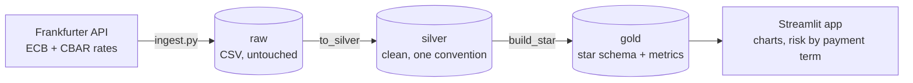
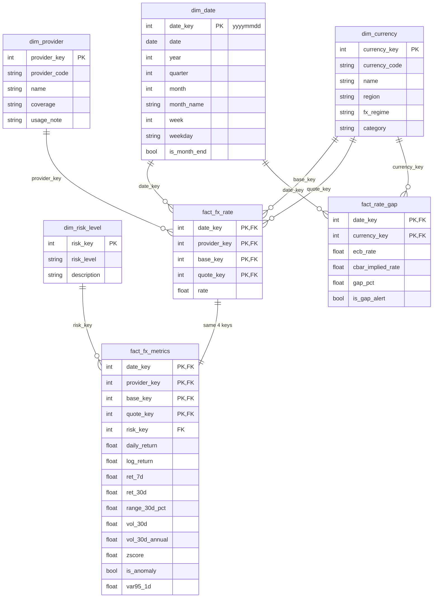
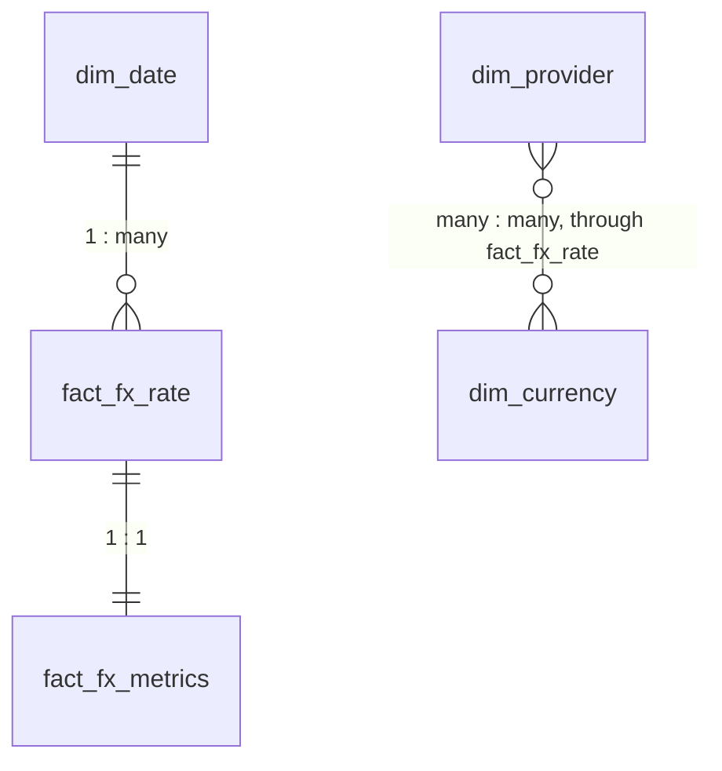

# FX Risk & Anomaly Monitor

**YUNEX 2026 Hackathon, Challenge 01: Recode Finance (reference demo)**

A small end-to-end data-engineering demo. Official exchange rates from two central banks (the ECB and the
Central Bank of Azerbaijan) are stored in MinIO, cleaned with pandas, modelled as a **star schema**, and shown
in a Streamlit app that flags unusual currency moves and gives a simple **Low / Medium / High** risk label.

---

## 1. Purpose

**The problem.** Anyone who is paid or pays in a foreign currency is exposed to exchange-rate moves:
freelancers, small exporters, students paying fees abroad, families sending money home. Banks have risk desks.
Everyone else has no simple way to tell whether a currency is calm or dangerous right now.

**The solution.** Take free, official daily rates, measure how unstable each currency has been, flag unusual
jumps, and translate the result into a plain label and an amount in the user's own money, for the time the
user has to wait until the payment.

**Why it fits the challenge.** Challenge 01 names security, accessibility and user experience of financial
services. This demo is an accessibility angle: risk information that a non-expert can read.

**What it is not.** It is not a trading tool, a forecast or financial advice. Official rates are published once
a day, so there is no intraday data. Anomaly flags are statistical.

---

## 2. A short story (fictional)

Leyla runs a small carpet workshop in Quba. A shop in Krakow orders carpets worth **10,000 euros**, payable in
30 days. Her costs (wool, dyes, wages) are in manat. She calculates that 10,000 euros is about 19,000 manat,
which covers everything and leaves a profit, so she says yes.

Three weeks later the euro has dropped against the manat. The same invoice is worth less, and a month of her
margin is gone. Nobody did anything wrong and nobody warned her. She is not a bank and has never heard of
"volatility". She only needed to ask one question before signing: *how risky is this deal?*

**With the app**, before accepting the order she picks `EUR/AZN` and:

1. sees how the rate behaved, with red markers on the unusual jumps of the past;
2. sets the expected payment date (30 days away) and types 10,000 euros. The app shows how many manat the invoice
   could lose by that date in 1 case out of 20, draws that downside as a dashed line on the chart, and gives one
   word for the risk of that waiting time (**Low**, **Medium** or **High**);
3. if the buyer will not fix the date, reads the table of payment terms (7 to 180 days) and sees how the risk grows
   the longer she waits, so she can plan for the longest wait she could face;
4. checks that the ECB and the Central Bank of Azerbaijan agree on the rate, so her buyer's bank and her tax
   office will not surprise her.

Then she decides: ask for a shorter payment term, add a small safety margin to the price, or ask for part of the
money upfront.

---

## 3. Architecture



| Layer | Where | What it holds |
|---|---|---|
| raw | MinIO bucket `raw/` | CSV exactly as the API returned it |
| silver | MinIO bucket `silver/` | One clean table: duplicates and bad values removed, both sources unified |
| gold | MinIO bucket `gold/` | The 7 star-schema tables, as parquet |

The risk for a chosen payment date is calculated by the app on the fly from the gold tables (`src/horizon.py`).
It is not stored in the star schema.

## 4. Data sources

Both come from the free [Frankfurter API v2](https://frankfurter.dev) (no key), pinned to a single provider so
the numbers are official and reproducible.

| Source | Request | Convention |
|---|---|---|
| ECB | `/v2/providers/ecb/rates.csv?base=EUR&quotes=USD,PLN,GBP,CHF,TRY,CZK,JPY` | 1 EUR = x currency |
| CBAR | `/v2/providers/cbar/rates.csv?base=AZN&quotes=USD,EUR,TRY,PLN,GBP,CHF,CZK,JPY` | 1 AZN = x currency, inverted in silver to 1 currency = x AZN |

Raw shape: `date, base, quote, rate`. There are no weekend or holiday rows. The manat is pegged to the US dollar
(about 1.70), so `USD/AZN` is flat. It acts as a control: the model must show no anomalies and Low risk for it.

---

## 5. Data model

A **star schema** has **fact tables** (measurements, many rows) in the middle and **dimension tables**
(descriptions, few rows) around them. A **PK** (primary key) identifies a row in its own table. An **FK**
(foreign key) is a column that points to the PK of another table.

### 5.1 Entity-relationship diagram



The facts have **composite primary keys**: no single column identifies a row, but the combination does. The
relationships are logical: the data is stored as parquet files, which do not enforce constraints, and the tests
in `tests/test_pipeline.py` check that the keys match.

### 5.2 Reading the cardinalities



| Symbol | Meaning |
|---|---|
| `\|\|` | exactly one |
| `o\|` | zero or one |
| `o{` | zero or many |
| `\|{` | one or many |

### 5.3 Relationships in words

| From (the "one" side) | To (the "many" side) | Type | Key | Meaning |
|---|---|---|---|---|
| `dim_date` | `fact_fx_rate` | 1 : many | `date_key` | One date has many rates (every provider and pair) |
| `dim_provider` | `fact_fx_rate` | 1 : many | `provider_key` | One source publishes many rates |
| `dim_currency` | `fact_fx_rate` | 1 : many | `base_key` | One currency is the base of many rates |
| `dim_currency` | `fact_fx_rate` | 1 : many | `quote_key` | One currency is the quote of many rates |
| `fact_fx_rate` | `fact_fx_metrics` | **1 : 1** | the 4 composite keys | Each published rate has exactly one row of calculated metrics |
| `dim_risk_level` | `fact_fx_metrics` | 1 : many | `risk_key` | One risk label applies to many days |
| `dim_date` | `fact_rate_gap` | 1 : many | `date_key` | One date has a gap check per currency |
| `dim_currency` | `fact_rate_gap` | 1 : many | `currency_key` | One currency has a gap check every day |

**Many-to-many.** A provider publishes many currencies, and a currency is published by many providers. A date has
many currencies, and a currency has many dates. A database cannot store many-to-many directly, so the fact table
sits in the middle as a **bridge**: every row of `fact_fx_rate` is one valid combination of date, provider,
base and quote.

**Role-playing dimension.** `dim_currency` is used twice by the same fact (as `base_key` and as `quote_key`).
Same table, two roles. In `EUR/TRY`, EUR is the base and TRY is the quote.

**Derived, not linked.** `fact_rate_gap` has no key to a single `fact_fx_rate` row. It is computed from ECB and
CBAR rows together, so its grain is one row per date and currency.

### 5.4 Table dictionary

| Table | Type | Grain (one row is...) | Primary key |
|---|---|---|---|
| `dim_date` | dimension | one calendar date | `date_key` |
| `dim_currency` | dimension | one currency | `currency_key` |
| `dim_provider` | dimension | one data source | `provider_key` |
| `dim_risk_level` | dimension | one risk label | `risk_key` |
| `fact_fx_rate` | fact | one provider x date x base x quote | `date_key, provider_key, base_key, quote_key` |
| `fact_fx_metrics` | fact | same as above | same 4 keys |
| `fact_rate_gap` | fact | one date x currency | `date_key, currency_key` |

### 5.5 Metrics in plain words

| Metric | Meaning |
|---|---|
| `daily_return` | % change since the previous published rate |
| `log_return` | The same change on a log scale (adds up over time) |
| `ret_7d`, `ret_30d` | % change over the last 7 / 30 observations |
| `range_30d_pct` | (highest - lowest) / average over 30 observations: how wide the swings were |
| `vol_30d`, `vol_30d_annual` | Volatility: how much daily returns jump around, over 30 observations; the annual one is scaled by sqrt(252) |
| `zscore` | How unusual today's move is compared with the previous 30 days (no look-ahead). 0 is normal |
| `is_anomaly` | `abs(zscore) > 3` |
| `var95_1d` | Value-at-Risk: the 5th-percentile daily return over 90 observations. "On 1 day in 20 you lose at least this" |
| `risk_level` | Low / Medium / High: terciles of `vol_30d_annual` across all series |
| `gap_pct` | CBAR-implied EUR cross rate vs the ECB rate, in %. Above 1% sets `is_gap_alert` |

**Risk for a payment term** (calculated in the app, not stored in the star schema):

| Term | Meaning |
|---|---|
| Business days | Calendar days until payment x 5/7, because rates are published on working days only |
| Downside (scaling) | `abs(var95_1d)` x sqrt(business days). Assumes daily moves are independent, so it is a rough estimate |
| Downside (past periods) | The 5th-percentile fall of the rate over every past period of the same length. Needs at least 60 past periods |
| Used | The higher of the two estimates, to err on the cautious side |
| Risk for the term | Low below 2% of the invoice, Medium from 2% to 5%, High at 5% or more (`HORIZON_LOW` and `HORIZON_HIGH` in `src/config.py`) |

**Optional date range.** In the sidebar, "Calculate the risk from a date range" lets the user pick a From and To
date. The risk, the volatility figure, the anomaly count and the tables then use only the rates between those dates
(the 1-day downside becomes the 5th percentile of the daily moves inside the range). With the box unticked, the full
history is used. A range needs at least 30 daily moves (`HORIZON_MIN_OBS`, about 6 weeks), otherwise the app shows
"Unknown" and a warning. The "past periods" estimate needs 60 periods, so for short ranges only the scaling estimate
is available.

**Totals over the period.** The section "What happened between ... and ..." (or "over the full history" when no range
is chosen) shows what actually happened as **totals in money, not daily figures**, for the invoice size the user typed:

| Figure | Meaning |
|---|---|
| Total change | Value of the invoice on the last day of the period minus its value on the first day |
| Biggest fall from a high point | The largest total loss between a high point and a later low point inside the period. It is drawn in red on the chart |
| Worst stretch of the payment term | The largest total loss over any stretch as long as the chosen payment term (needs a period longer than the term) |

These are past outcomes, not forecasts. The 1-in-20 figure in the blue box is the forward-looking estimate, also a
total up to the payment date.

This is one-sided: it is the fall in the rate that hurts someone who holds the **base** currency (for example
euros that will be converted to manat). Someone who will receive the quote currency is hurt by a rise instead.
`risk_level` in `fact_fx_metrics` is a different thing: it compares recent volatility across currencies and does not
depend on the payment date. The app shows it as "Recent behaviour".

---

## 6. Run it

```bash
make run          # MinIO (Docker) -> ingest -> transform -> Streamlit
```

Or step by step:

```bash
python -m venv .venv && source .venv/bin/activate
pip install -r requirements.txt

docker compose up -d                    # MinIO: API :9000, console :9001 (login from .env)
python src/ingest.py                    # live API -> MinIO raw/
python src/transform.py                 # raw -> silver -> gold
streamlit run src/app.py                # http://localhost:8501
```

No Docker or no internet?

```bash
make offline                            # synthetic data, files in ./data, then the app
```

`make help` lists all commands, and `make test` (or `pytest -q`) runs the tests. The synthetic data in
`src/sample_data.py` is invented: use it only as a backup, and do not present it as real rates.

## 7. Querying the star in pandas

```python
import sys

sys.path.insert(0, "src")
from storage import Store
from transform import flatten

s = Store()
tables = [
    "dim_date",
    "dim_currency",
    "dim_provider",
    "dim_risk_level",
    "fact_fx_rate",
    "fact_fx_metrics",
    "fact_rate_gap",
]
star = {t: s.get_parquet("gold", f"{t}.parquet") for t in tables}
flat = flatten(star)  # the whole star joined into one wide table

# riskiest pairs right now
(
    flat.sort_values("date")
    .groupby("pair")
    .tail(1)
    .sort_values("vol_30d_annual", ascending=False)[["pair", "rate", "risk_level"]]
)
```
